<div align="center">

# ContextOS

**面向 AI 编程 Agent 的全场景本地桌面工作台与上下文操作系统**

[](https://www.rust-lang.org/)
[](https://github.com/zed-industries/zed)
[](https://modelcontextprotocol.io/)
[](LICENSE)
[]()

[功能特性](#-功能特性) • [界面预览与使用流程](#-界面预览与使用流程) • [支持的-agent-生态](#-支持的-agent-生态) • [快速开始](#-快速开始) • [mcp--cli-集成](#-mcp--cli-集成) • [致谢与许可](#-致谢与许可)

</div>

---

## 📖 简介

在日常开发中使用多种 AI 编程工具时，开发者的会话记录往往分散在各个 Agent 的专有目录中，项目历史改动的上下文难以审计回溯，超长会话极易超出 Token 窗口并丢失关键记忆。

**ContextOS** 是一个专为 AI 编程 Agent 设计的高性能本地桌面工作台与上下文中心。它把散落在本机各个 Agent 中的会话、项目文件改动和可复用记忆资产统一汇聚，提供毫秒级全文检索、按轮次无损压缩、工作区时间线快照，并通过 **桌面 GUI**、**`contextos-mcp`** 与 **`contextos-cli`** 三位一体的方式，让用户和 Agent 能够跨工具继续组合与利用这些上下文资产。

---

## 🖼️ 界面预览与使用流程

### 1. 全景多 Agent 会话归拢与全文检索
扫描本地多个编程 Agent 的历史记录，按 Agent 和项目聚合会话，秒级全文搜索并直达消息详情、思考链与工具调用。
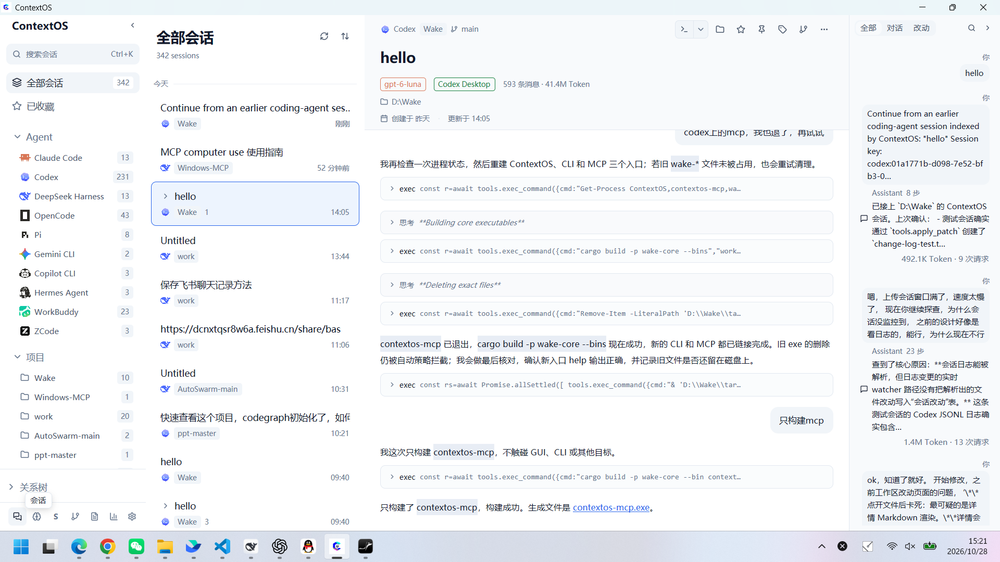

---

### 2. 双重视角改动追踪：工作区改动与会话改动
实时捕获用户工作区的文件物理增删改，同时清晰对照 Agent 会话日志明确执行的文件操作，双重视角互为印证。

| 工作区改动（文件系统变动） | 会话改动（Agent 操作记录） |
| :---: | :---: |
| 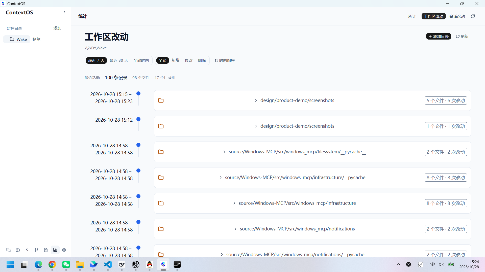 | 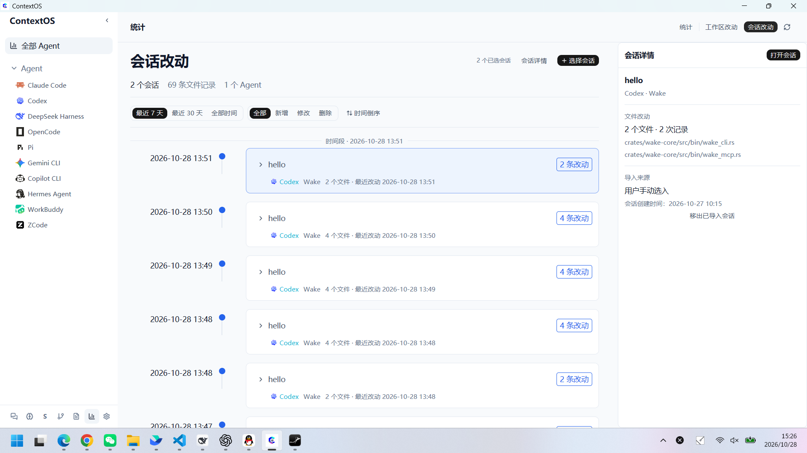 |

---

### 3. 多维度活动统计与使用洞察 (Insights)
按 Agent、项目、模型和时间维度展示会话频次、Token 消耗排行、活跃热力图以及 ContextOS MCP / CLI 的调用量。

| 活跃热力图与统计概览 | 模型与 Token 消耗榜单 |
| :---: | :---: |
| 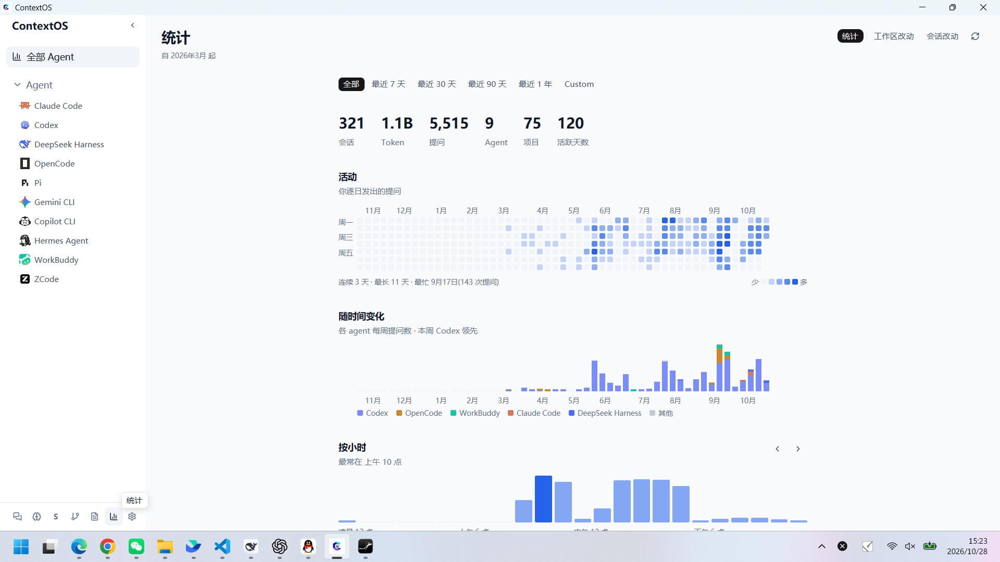 | 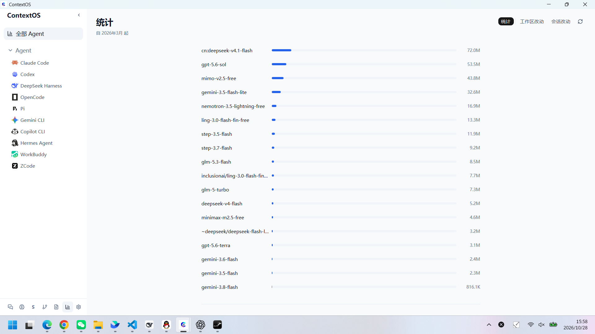 |

---

### 4. 记忆资产沉淀与会话关系图谱
集中管理 Agent 自主沉淀的长期记忆（如 Codex memory、Claude memory）与项目指令文件（`AGENTS.md`、`CLAUDE.md` 等），直观展示会话间的前后演进与关联关系。

| 长期记忆库总览 | 会话关系网络图谱 |
| :---: | :---: |
| 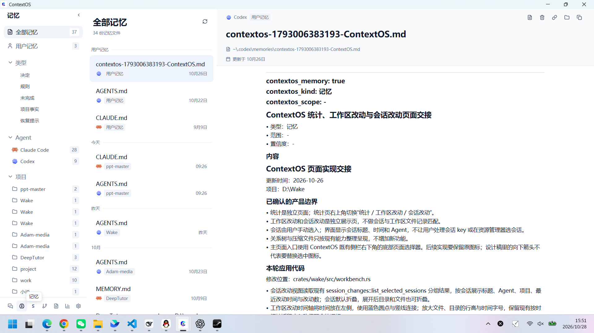 | 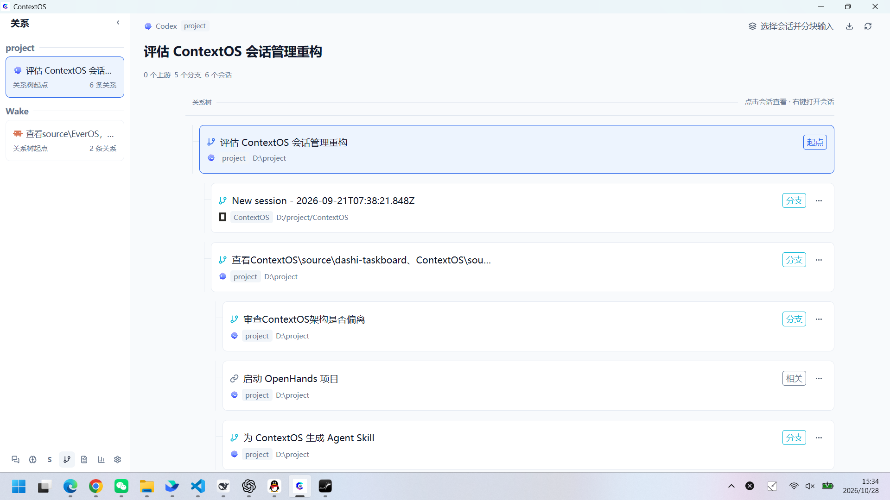 |

---

### 5. Skill 插件生态与 MCP 客户端互通
统一浏览、管理和编辑跨 Agent 的 Skill 插件，监控已注册的 MCP 服务端及兼容客户端的连接状态。

| Skill 插件库与多级范围管理 | MCP 服务状态与客户端同步 |
| :---: | :---: |
| 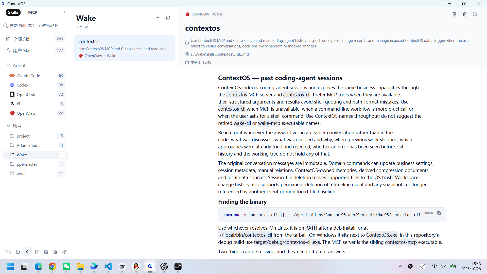 | 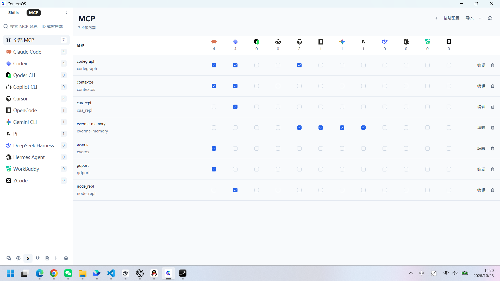 |

---

### 6. 长会话按轮次智能压缩与模型策略
组合机械规则、Jev 评估与可配置 LLM 策略，严格基于对话完整轮次（Turn-based）打包切块，不截断上下文，生成精炼的高密度上下文文档。

| 压缩文档资产库 | 多级压缩策略与模型配置 |
| :---: | :---: |
| 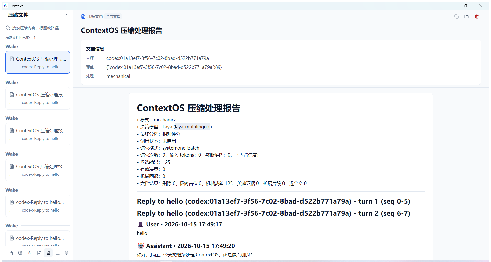 | 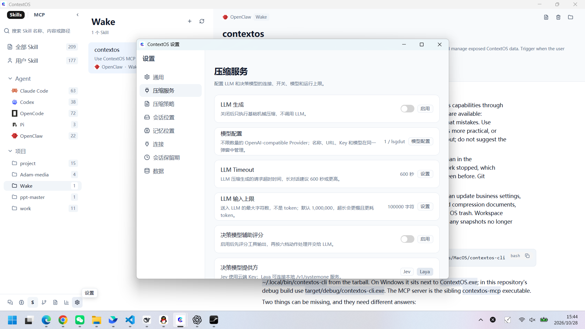 |

---

## ✨ 核心特性

- **本地零拷贝适配**：开箱支持 19 家主流 AI 编程 Agent 的本地数据解析器，实时侦听会话写入，保持 FTS 索引与消息序号毫秒级同步。
- **深层定位与恢复**：查看对话文本、Thinking 思考过程、Tool Calls 输入输出及 Token 统计，支持直接从原工程目录终端恢复会话。
- **真实文件改动审计**：同时展现“文件系统实际变动快照”与“Agent 会话明确执行的文件操作”，精准复盘 Agent 改动。
- **轮次完整性压缩**：彻底告别盲目字符截断，按对话 Turn 边界分块，多层策略结合提取复用记忆候选。
- **Agent 原生驱动**：桌面应用、MCP 独立服务端与 CLI 共享底层 Rust 业务实现，Agent 可自主调取历史、读取快照与管理记忆。
- **本地优先与隐私安全**：索引与快照完整保存在本地 SQLite，绝不静默上传数据；仅在显式配置 LLM/Jev 或 SSH 远程同步时连接指定端点。

---

## 🤖 支持的 Agent 生态

ContextOS 开箱支持 **19 家** 主流 AI 编程 Agent 与命令行工具的本地数据索引与上下文解析：

| 分类 | 支持的 Agent |
| :--- | :--- |
| **主流 Agent CLI** | Claude Code, Codex, Cursor, Gemini CLI, Copilot CLI, Kimi Code |
| **开源与自主 Agent** | OpenCode, Grok Build, DeepSeek Harness (DSH), Pi, OMP, Kiro, Hermes, OpenClaw |
| **专业与自研套件** | Antigravity, Qoder, CodeBuddy, WorkBuddy, ZCode |

---

## 🚀 快速开始

### 从源码构建

ContextOS 基于 **Rust (2021 edition)** 与高性能 GPU 渲染引擎 **GPUI** 构建：

```bash
# 1. 克隆仓库
git clone https://github.com/KeLe3377/ContextOS.git
cd ContextOS

# 2. 运行对应平台的构建脚本：
# macOS
scripts/make-app.sh

# Linux
scripts/make-linux.sh

# Windows (PowerShell)
powershell -ExecutionPolicy Bypass -File scripts/make-windows.ps1
```

> **本地开发命令**：
> - 启动桌面端：`cargo run -p wake`
> - 构建 Windows 开发二进制：`powershell -File scripts/build-dev.ps1`

---

## 🛠️ MCP 与 CLI 集成

### 1. 配置 `contextos-mcp`
运行以下命令可自动为当前环境的 AI Agent 输出配置片段：

```bash
contextos-mcp setup
```

例如在 Codex (`config.toml`) 中配置：
```toml
[mcp_servers.contextos]
command = "contextos-mcp"
```

### 2. 核心 MCP 工具
- `contextos_search` / `contextos_list_sessions`：跨 Agent 检索历史会话与上下文
- `contextos_list_workspace_changes` / `contextos_get_workspace_change`：查看工作区文件变动与前后文本差异
- `contextos_compression`：按轮次无损压缩超长会话并生成摘要与长效记忆候选
- `contextos_memories` & `contextos_settings`：长效记忆维护与压缩策略热配置

### 3. CLI 命令行常用示例
```bash
# 搜索包含关键字的历史会话
contextos-cli search "Token" --agent codex --agent antigravity

# 查看指定会话的消息与工具调用详情
contextos-cli show "antigravity:SESSION_ID" --tools

# 查看工作区最近变更
contextos-cli workspace-changes --project "$PWD" --since 24h
```

> 详细工具协议与 CLI 语法说明请参见 [`docs/mcp.md`](docs/mcp.md) 与 [`docs/cli.md`](docs/cli.md)。

---

## 🤝 致谢与许可

- ContextOS 基于 [iAmCorey/Wake](https://github.com/iAmCorey/Wake) 进行二次开发。感谢 Corey Chiu 及 Wake 社区为会话浏览器、数据适配器以及 GPUI 跨平台桌面端所奠定的扎实基础。
- 本项目遵循 **[MIT 许可协议](LICENSE)**。在使用或分发基于 Wake 的代码时，请遵守上游的 [MIT 许可条款](https://github.com/iAmCorey/Wake/blob/main/LICENSE)。
